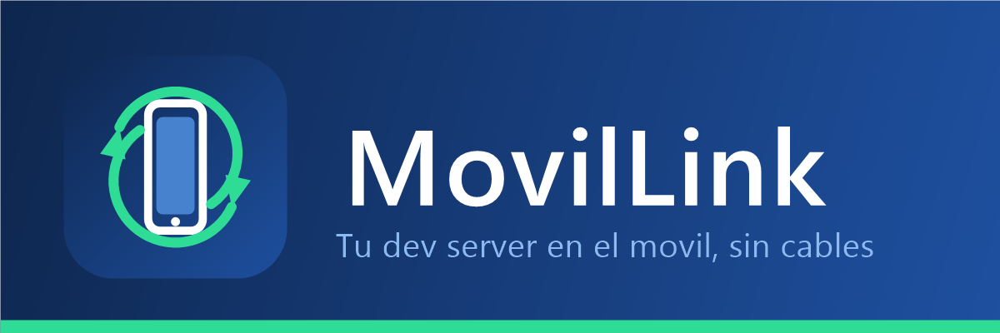
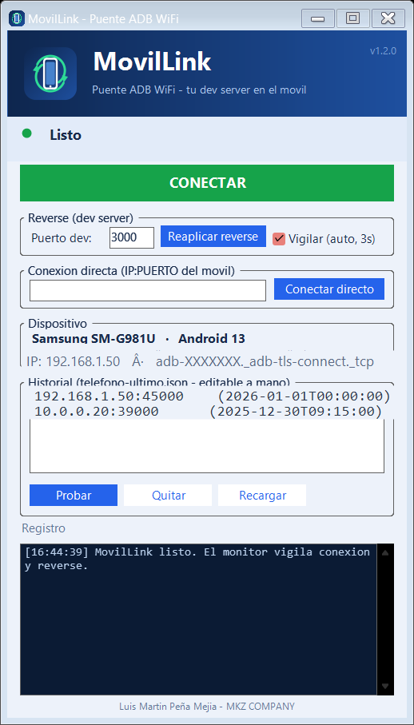

<div align="center">




-1E7A3C?style=flat-square&logo=android&logoColor=white)


</div>

Probar tu dev server en el móvil no debería ser una misión: `adb pair` se
hace una vez, pero la conexión muere a cada rato, el puerto rota al
apagar/encender la depuración inalámbrica y `adb reverse` **se pierde con
cada reconexión** — Chrome del móvil se queda en blanco aunque `adb
devices` diga "conectado".

MovilLink conecta el teléfono **solo** (mDNS → ficha → vecinos → subred →
barrido de puerto) y un monitor vigila la conexión cada 3 segundos: si se
cae reconecta, y si el reverse falta lo re-aplica. Tú solo recargas la
pestaña.

<div align="center">



</div>

## Descargar

| Vía | Enlace | Para quién |
|---|---|---|
| **Release ZIP** | [MovilLink-v1.2.2.zip](https://github.com/luismartin023/movillink/releases/latest) | Todos — la forma recomendada |
| **NuGet** | [MovilLink en GitHub Packages](https://github.com/luismartin023/movillink/pkgs/nuget/MovilLink) | `dotnet add package MovilLink` |
| Code → Download ZIP | Este repo | Si quieres el código fuente completo |

## Necesarios

Lo que el usuario debe tener — el menú lo resuelve solo:

| Herramienta | Para qué | Cómo se instala |
|---|---|---|
| **Android Platform-Tools** (`adb`) | **El corazón de la app** — conectar el móvil a la PC por WiFi para el dev de localhost | Opción `[2]` del menú — winget (global) o ZIP oficial portable a `APP\platform-tools\` |
| **PowerShell 5.1+** | La app entera | Ya viene en Windows 10/11 |
| **Depuración inalámbrica ON** en el móvil | Que el PC lo vea | Ajustes → Opciones de desarrollador → Depuración inalámbrica (misma WiFi) |
| **Vinculación** (una sola vez) | `adb pair IP:PUERTO` con el código del móvil | Manual, la primera vez por PC |

Si falta `adb`, la propia app te lo dice y ofrece **INSTALAR AHORA** —
lanza el instalador por ti.

## Uso

```
1. MovilLink.bat  (doble clic → abre el ASISTENTE paso a paso)
2. El menú te dice qué falta:  [1] antivirus → [2] instalar adb → [3] abrir app
3. Pulsa CONECTAR → en el móvil abre http://localhost:3000
```

> Un solo `.bat` en la raíz: un menú que muestra el estado en vivo
> (adb / móvil / reverse) y te guía en orden. Si falta adb, la propia
> app también ofrece **INSTALAR AHORA**. La ventana se abre sin consola
> vía `APP\Lanzador.vbs` — ni cmd, ni icono de PowerShell en la barra.

- **CONECTAR** (botón verde): el plan completo automático.
- **Vigilar** (activo por defecto): reconecta y re-aplica el reverse solo.
- **Conexión directa**: escribe el `IP:PUERTO` de la pantalla del móvil.
- **Historial**: la lista `APP\Datos\telefono-ultimo.json` — prueba
  entradas de una en una o edítala a mano.
- **Consola**: opción `[4]` del menú — mismo motor por terminal.

## Cómo conecta (orden real)

```
1. mDNS          autoconnect del daemon (reinicia el daemon si está zombie)
2. Ficha JSON    endpoints conocidos, misma red primero  <- plan B manual
3. Vecinos ARP   IPs vecinas con los puertos de la ficha
4. Subred /24    barrido paralelo con puertos conocidos
5. Puerto rotado si la IP vive pero el puerto cambió: rango efímero
                 32768-60999 solo en esa IP + adb connect real
```

## Avisos antes de usar

- **SmartScreen (pantalla azul)**: al abrir un .bat descargado Windows
  puede decir "protegió tu PC". Es normal con herramientas sin firma
  digital → clic en "Más información → Ejecutar de todas formas".
- **0-Preparar-Antivirus.bat pide administrador**: agrega la carpeta a las
  exclusiones de Windows Defender. Solo cubre Defender; con otro antivirus
  agrega la carpeta a sus exclusiones.
- **El puerto del móvil rota** al apagar/encender la depuración
  inalámbrica o reiniciar — MovilLink lo encuentra solo (punto 5 de arriba).
- **La ficha es manual y automática**: `telefono-ultimo.json` guarda los
  endpoints que funcionaron (máx 8) y acepta edición a mano — es el plan B
  cuando la red no pasa multicast (hotspots, WiFi de invitados).

## Estructura

```
├── MovilLink.bat              UNICO lanzador: menu asistente paso a paso
├── README.md · LICENSE · CHANGELOG · CONTRIBUTING · CODE_OF_CONDUCT · SECURITY
└── APP/                        dividida por dominios
    ├── Core/        MovilLink.Core.ps1 — orquestador (Connect-Auto, reverse)
    │   └── Dominio/ adb.ps1 · red.ps1 · ficha.ps1 — dominio puro
    ├── Datos/       telefono-ultimo.json (ficha viva, gitignored) + ejemplo
    ├── Interfaz/    MovilLink.UI.ps1 — adaptador WinForms (DPI-aware)
    ├── Consola/     MovilLink.CLI.ps1/.bat — adaptador terminal
    ├── Recursos/    logo.png · app.ico · banner.png · captura.png
    ├── Lanzador.vbs           abre la ventana sin consola
    ├── Estado.ps1             linea de estado para el menu
    ├── Diagnostico.ps1        adb / mDNS / reverse / ficha de un vistazo
    ├── Preparar-Antivirus.ps1 exclusion de Defender (self-elevating)
    └── Instalar-Necesarios.ps1 instalador de dependencias
```

La lógica vive solo en `Core/`; la ventana y la consola son adaptadores
que lo consumen — no hay código duplicado entre interfaces. Los errores se
capturan en `logs/error-*.log`.

## Autor

**Luis Martin Peña Mejia** — Fundador y CTO de **MKZ COMPANY** 🇩🇴
Estudiante de Ingeniería de Software, UCE Punta Cana · Matrícula 2023-4341
[@luismartin023](https://github.com/luismartin023) · República Dominicana

> MovilLink es un desarrollo de **MKZ COMPANY** nacido de un flujo real:
> probar Frontera MKZ en el móvil todos los días sin pelear con adb.

## Licencia y aviso legal

Software libre bajo **licencia MIT** — ver [LICENSE](LICENSE). Puedes
usarlo, copiarlo y modificarlo libremente.

MovilLink **no está afiliado ni respaldado por Google**; "Android" y "adb"
son marcas de sus respectivos propietarios. Es una herramienta local: no
envía datos a ningún servidor.
